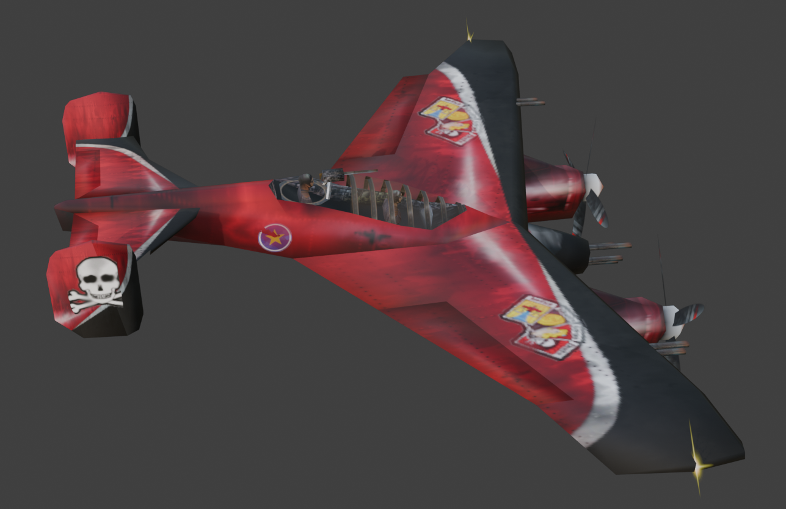
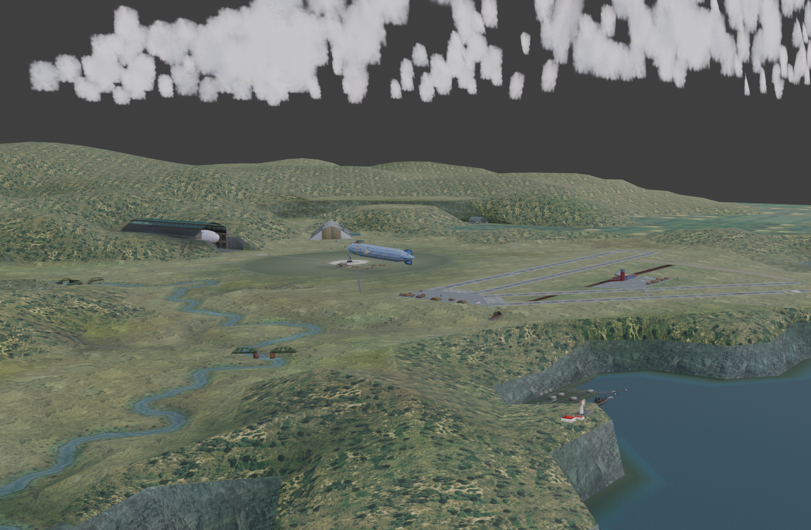
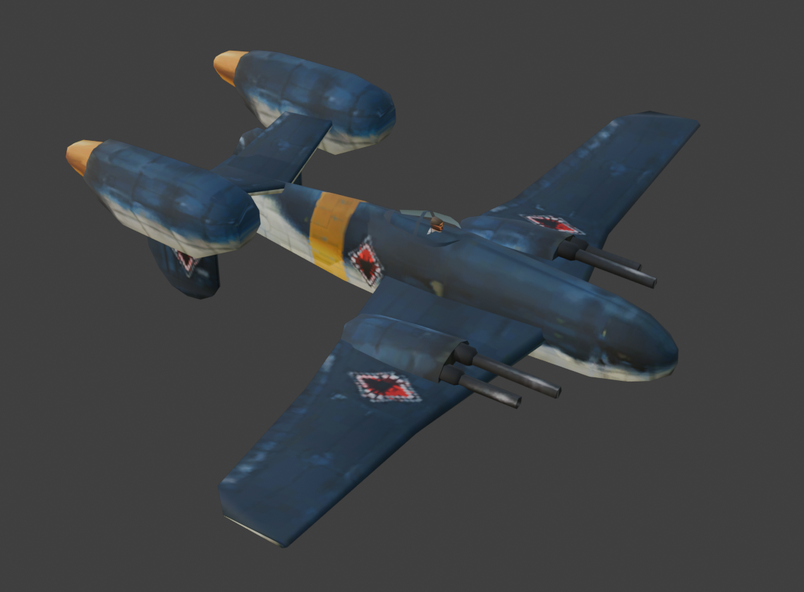
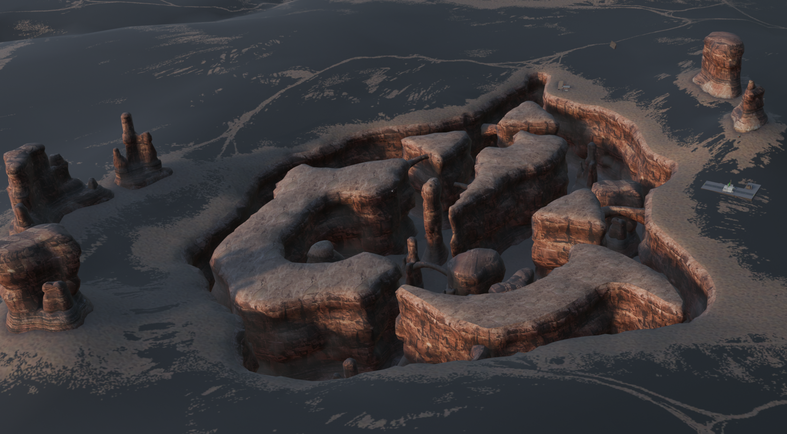
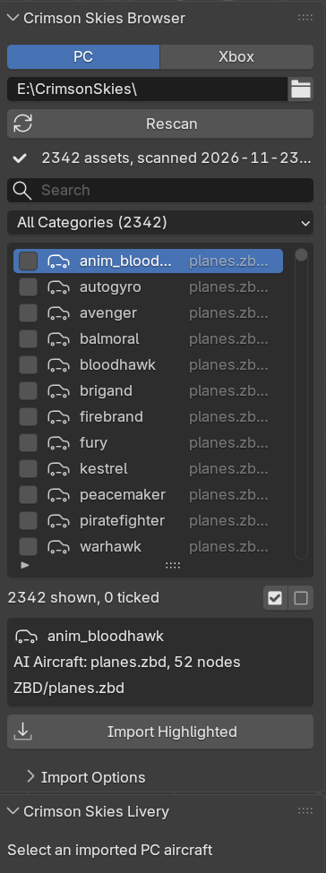

# Crimson Skies Importer for Blender

A Blender 5.2 extension (works from 4.4) that imports models, materials, animations and levels
from both games:

- **Crimson Skies** (PC, 2000): read from an install folder.
- **Crimson Skies: High Road to Revenge** (Xbox, 2003): read straight from the disc image
  (`.iso` / `.xiso`), with no extraction step, or from extracted `.bin` / `.zip` / `.x` files.

No game data is included. You need your own copies of the games.

| PC aircraft, painted at import | PC chapter world |
|---|---|
|  |  |
| **Xbox aircraft** | **Xbox level** |
|  |  |

## Install

1. Download the zip from the [latest release](https://github.com/Tzeentchnet/CrimsonSkies-Blender/releases/latest)
   (it is also in `dist/`), or build it:
   `blender --command extension build --source-dir crimson_skies_importer --output-dir dist`
2. In Blender, go to *Edit > Preferences > Get Extensions*, open the drop-down at the top right,
   choose *Install from Disk…* and pick the zip.

There are two ways in: the **asset browser** in the 3D view's sidebar (*N > Crimson Skies*), or
**File > Import > Crimson Skies**.

## Asset browser

1. Choose **PC** or **Xbox** at the top of the panel, then set the source. For PC, that's the
   Crimson Skies install folder (the one holding `ZBD` and `GOSDATA`). For Xbox, it's the
   disc image (`.iso` / `.xiso`, or a folder of extracted packages).
2. Press **Scan**. This indexes every importable asset in about a second. The scan is cached on
   disk, so the list comes back after a restart, after loading a file, and after switching games,
   without scanning again. If the source's files change, the panel says the cache is stale.
3. Use **Search** (every word must match the name, category or source) and the **Category**
   menu to narrow the list. Then tick assets and press **Import**, or highlight one row and
   import that.

| Game | Categories |
|---|---|
| PC | Player Aircraft, AI Aircraft, Characters & Props (from `planes.zbd`); Levels (each chapter world, alone or with a mission's animations); Level Objects, Effects, Destroyed States (each chapter's other root objects, with templates repeated across chapters listed once) |
| Xbox | Levels, Multiplayer Levels, Player / AI / Ambient Aircraft, Other Packages (whole packages); Props, Vehicles, Zeppelins, Turrets & Defenses, Characters, Bosses, Pickups & Targets, Skies, Effects, Aircraft Models, Debris & Damage (each distinct model of the level packages) |

A level object imported on its own keeps its world position.

 

### Preferences

*Edit > Preferences > Add-ons > Crimson Skies Importer* holds the sources and the import options
that the browser and the File menu share. The same options are in the browser's *Import Options*
subpanel.

| Option | Default | What it does |
|---|---|---|
| Import LODs | Off | PC: the lower levels of detail go into a `<model> LODs` collection with its visibility off. The Xbox game ships no LOD models. |
| Import Collisions | Off | Xbox: the `collide_N` cards and `boundbox` nodes go into a `<model> Collision` collection, as wireframe and hidden from renders. PC has no separate collision meshes: each object gets a `cs_collision` property (`surface`, `bbox` or `none`, from the node's flags), and every bounding-box collider gets a wireframe box. |
| Damage States | Off | **Off**: damage panels, damage-state subtrees, destroyed pieces and debris or wreck models are left out. **On**: they are imported in place and visible. **Hidden**: they go into their own `<model> Damage` collection, with its visibility off. |
| Animations, Pack Images | On | As in the File menu importers. |
| Livery / Team Skin | Fortune Hunters / No Team | The PC livery painted at import, and the Xbox multiplayer skin. |

Damage states are the PC aircraft's `pdp*`/`pcdp*` panels, `player_damage_on/off`, `destroyed`
and its pieces, cockpit bullet holes and the destroyed variants of world destructibles. On Xbox
they are the `<model>_dmg1`…`_dmgN` subtrees (`_dmg0` is the healthy state), `*debris*` nodes and
models, and the `*_fusalage` wreck models. A debris model you pick in the browser is always
imported.

Preferences are also written to `settings.json` in the add-on's user folder, next to the scan
cache, and restored when the add-on is enabled. They survive a factory reset or a reinstall.
*Clear Scan Cache* in the preferences deletes the cached scans.

## PC (Crimson Skies)

| Menu entry | File to pick | What you get |
|---|---|---|
| PC Models (planes.zbd) | `ZBD\planes.zbd` | Every aircraft and its node tree, textured, laid out in a grid |
| PC Level (gamez.zbd) | `ZBD\<chapter>\gamez.zbd` (C1, C1B, C1C, C2, C2B, C3, C4, C5) | The chapter world: terrain, buildings, sky, clouds, vehicles |

Options:

- **Root Filter**: comma-separated names or wildcards, for example `player_bhawk` or `player_*`.
- **LODs, collisions and damage states** follow the add-on preferences (see above).
- **Flight-Ready State**: hides the shadow and propeller spin frames that the game starts hidden. **Cockpit Interior** also imports the separate cockpit model.
- **World Content Only** (levels): imports the world node and its partitioned scenery, and leaves
  out effect templates such as bullet holes and letterbox bars.
- **Mission** (levels): a mission folder such as `M02`, whose `mis_anim.zbd` animations are added
  to the chapter's `cam_anim.zbd` ones.
- **Vertex Colors / Unlit / Custom Normals**: material and shading choices. *Unlit* matches the
  original's fullbright world.

### Liveries (paint patterns from `crimson.rof`)

The skins in `texture.zbd` are unpainted key textures; the game paints each aircraft at load time.
The importer does the same from `GOSDATA\ASSETS\crimson.rof` (with `crimptch.rof` applied):

| Painted at import | Repainted in the Sacred Trust livery |
|---|---|
|  |  |

- **Livery** (import option): one of the 14 patterns (Fortune Hunters, Black Hats, Blake's
  Bandits, British, Black Swans, Red Army, Hollywood Knights, Hughes, Medusas, Sacred Trust,
  German, Studio Security, Broadway, ITS Taxi), or *Shipped (unpainted)*. The default is
  Fortune Hunters, the only pattern every aircraft has. An aircraft without the chosen pattern
  falls back to Fortune Hunters with a warning.
- **Custom Colours**: Body, Dark Trim and Light Trim override the pattern's defaults. The
  defaults are the game's own (its hangar pattern and swatch tables).
- **Nose / Tail / Wing Decal**: any of the 50 numbered decals (squadron logos 00–20, nose art
  21–49), or the pattern's default.
- **Repaint after import**: select an imported aircraft and open *View3D sidebar (N) >
  Crimson Skies > Crimson Skies Livery*. The pattern list shows only the patterns that aircraft
  ships (the Bloodhawk offers Blake, Fortune and Hughes; the Hoplite Black Hats, Fortune,
  Studio and ITS Taxi), and choosing one loads its default colours. *Apply Livery* repaints
  every selected aircraft. Materials shared with other aircraft are copied first, so a repaint
  never changes another plane.

Per texel this is `shading × (w1·c1 + w2·c2 + w3·c3) / 255` with the pattern's overlay
composited on top, from each `.BM` skin's shading map, three region weights and RGBA overlay
(rows bottom-up), as documented by CSVM (`docs/formats/rof.md`, `paint.md`).

How the data maps into Blender:

- Textures come from the chapter's full-quality `texture.zbd`, with the other chapters and
  `rimage.zbd` as fallbacks. They are packed into the .blend, or written as PNG if you set
  **Texture Folder**.
- Animations are the compiled SI scripts (`.zan`, per-node splines). Each becomes an action,
  sampled at the scene frame rate, on the node it drives: the C1 train, the fuel trucks, the
  pilot-eject rig, and so on. Cutscene camera scripts become animated Blender cameras. When a
  node has more than one script, the first is the active action and the rest are muted NLA tracks.
- Fog volumes and Danger Zone paths come in as wireframe helpers that are hidden in renders.
- The game is Y-up; the import root is turned 90° about X, so the scene stands up in Blender
  while every node keeps its original local transform.

## Xbox (High Road to Revenge)

Pick the disc image with **Xbox: High Road to Revenge**, then set **Package / Entry**:

| Package / Entry | Result |
|---|---|
| `SH_Tutorial.bin` (any level `.bin`) | The level: every placed unit at its world position, the terrain and water chunks, lightmaps, and door/turret animations |
| `PF_Bandito.bin` | That aircraft package's models (main airframe, debris, fuselage) |
| `PF_*_Upgrade.bin` | Several packages at once, laid out in one grid |
| `SH_Tutorial.bin:parachute.x` | One model from a package, with every `.anm` of that package that drives it |

**Team Skin** picks the No Team, Team 1 or Team 2 variant of multiplayer aircraft
(`PF_*_MP*.bin`), which ship `…_noteam`, `…_Team1` and `…_Team2` versions of their skin.

If you leave **Package / Entry** empty, the importer lists the disc's 108 packages in the info log.
The **Import** mode can force *Level World*, *Models*, or *Models + Animations*.

What is imported:

- **Models**: the full node tree, with packed normals, up to four UV sets (`UV0` to `UV3`) and
  materials. The base texture drives the colour, and `~n` maps are wired in as normal maps. The
  other slots (damage overlays, `~a` masks, detail maps) are added as image nodes, unconnected,
  on their own UV maps.
- **Skinned models** (the parachutes): an armature built over the node tree, with vertex groups
  from the per-mesh joint tables.
- **Animations** (`.anm`): keyed onto objects, or onto pose bones for skinned models, at 30 fps.
- **Levels**: each lightmapped unit instance (`model.x|UnitName`) carries its own placement. The
  terrain and water chunks come from the world section. Lightmaps are multiplied in at 2x on `UV3`.
  A level package carries every animation its mission may play, so each one is keyed only onto
  the units it was made for: the ones holding most of its distinctive node names (Maya default
  names such as `pCube1` don't count). A `Model_Root` track is a world placement and goes to the
  unit placed where it starts (Final_Boss's `Beacon_Falling` and `Talon_Falling`). Units the
  game places by script (boss segments, explosion effects) sit at the origin.
- **Textures**: DXT1/3/5, swizzled 32-bit and R5G6B5, linear 16-bit masks, and the P8 lightmap
  atlases.

## Formats

The PC readers are ports of the CSVM project's C# readers. Its format documentation is in
`CrimsonSkies-csvm/docs/formats`.

The Xbox recomp publishes no asset formats, so the Xbox layouts here were reverse-engineered from
the disc and checked against all of it. Every one of the 6,734 models, 674 animations and
17,158 textures parses to its exact end, and every level's world section yields its declared
mesh count except `mp_CH1` (see Limitations). The layouts are written up in the docstrings of
`formats/xbox_package.py`, `xbox_model.py`, `xbox_anim.py` and `xbox_texture.py`. In brief:

- **Package `.bin`**: a header, either `{?, count}` for aircraft or `{?, 150, count, world mesh
  count}` for levels. Then `count` entries of `{u32 type, u32 name length, name, u32 size, data}`.
  Types: 1 model, 2 texture, 3 cube map, 4 `.anm`, 5 `.cin`, 6 sound, 7 light. Levels then
  have a world section.
- **Model**: `{version, bounds, flags}`, then a recursive node tree. Each node is
  `{name, 4x3 matrix, bounds, kind, meshes, children}`. Each mesh has a shader id, an ARGB colour,
  a texture-slot mask with one name per set bit, 32-byte vertices
  (`pos f32x3, NORMPACKED3 normal, 4 x s16x2 UV`), a per-set UV scale, optional tangent frames,
  a u16 triangle list, a strip/remap list, a bounding tree, and, in version 2 files only, skin
  weights. Coordinates are left-handed D3D. The triangle order is the back face relative to the
  stored normals.
- **`.anm`**: tracks of `{frame, pos, scale, shear, quat xyzw}` keys addressed by node name.

## Limitations

- Xbox: the world section's **scatter props** (palm trees, rocks, crates) are listed in each
  level collection's `cs_scatter_props` property but are not placed; their compressed placement
  grids are not decoded. `.cin` cinematics, cube maps and sounds are not imported. One chunk of
  `mp_CH1` is not found (268 of 269).
- Xbox materials follow inferred shader semantics: slot 0 is the base, `~n` is a normal map,
  `~a` is a mask, not transparency, and only DXT1's 1-bit alpha is used as cut-out. They are
  approximations of the game's shaders.
- PC: only the compiled SI-script animations are imported. Reader-driven motion (propeller spins,
  `OBJECT_MOTION_FROM_TO` cars, hangar doors) is not. Facade billboards keep their authored
  orientation; their mode is stored in the mesh's `cs_facade_mode` property. Overlay material
  passes are kept only as a second UV map called `Overlay`.

## Tests

`tests/blender_test.py` imports one case headless, saves a .blend and renders a preview, for
example `blender -b --factory-startup --python tests/blender_test.py -- pc_level_c1`.
`tests/operator_test.py` runs every import operator end to end.
`tests/browser_test.py` drives the sidebar browser headless: scan, search, every LOD, collision
and damage setting, the livery panel following the imported aircraft, and settings and cache
surviving a reset. Set `BLENDER_USER_CONFIG` to a test folder first, so its settings and cache
stay out of your own. `tests/ui_screenshot.py` opens a window and screenshots the sidebar. The default output folder is
`E:\tests\CrimsonSkies_Importer_20261123`.
